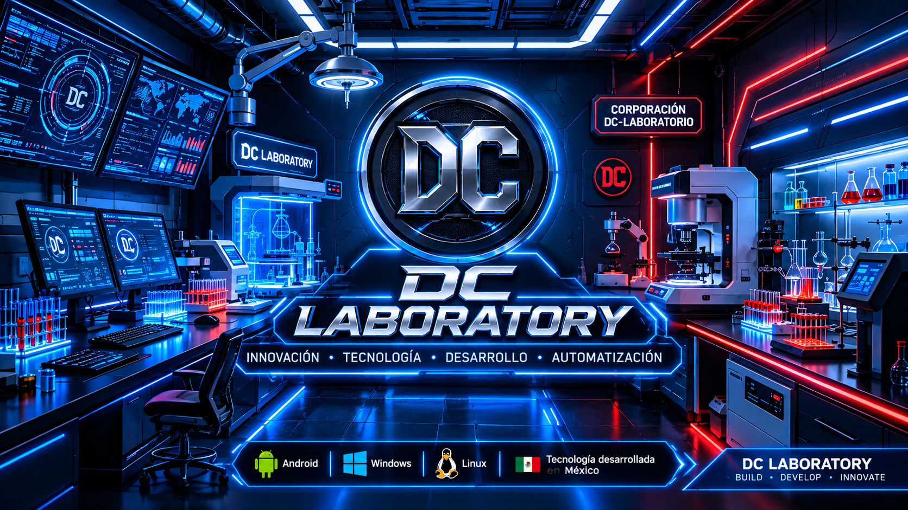

El Laboratorio · DC Laboratory

Portal de proyectos, herramientas y documentación de diagnóstico automotriz, sistemas embebidos y automatización.

""Security checks" (https://github.com/dcg0/El-laboratorio/actions/workflows/security.yml/badge.svg?branch=main)" (https://github.com/dcg0/El-laboratorio/actions/workflows/security.yml)
""CodeQL" (https://github.com/dcg0/El-laboratorio/actions/workflows/codeql.yml/badge.svg?branch=main)" (https://github.com/dcg0/El-laboratorio/actions/workflows/codeql.yml)
""Portal web" (https://img.shields.io/badge/Portal-GitHub_Pages-2ea44f?logo=github)" (https://dcg0.github.io/El-laboratorio/)

  

---

Abrir el laboratorio

  
  
  
  
  
  
  
  
  

"Visitar el portal web" (https://dcg0.github.io/El-laboratorio/) · "Ver las comprobaciones" (https://github.com/dcg0/El-laboratorio/actions) · "Reportar un problema" (https://github.com/dcg0/El-laboratorio/issues)

Información y contacto

Para ideas, colaboraciones o solicitudes de desarrollo, visita el "sitio oficial" (https://dcg0.github.io/DC-laboratory/) o el perfil de "GitHub" (https://github.com/dcg0).

Este repositorio contiene el sitio estático publicado en GitHub Pages, sus recursos y dos proyectos Android. Las páginas reúnen herramientas de diagnóstico OBD2/ELM327, proyectos con ESP32, interfaces de telemetría, cotizadores y demos.

Qué hay en el repositorio

Ruta| Contenido
"index.html"| Portada y catálogo de proyectos.
"dcscanner.html", "dcelm327.html", "hcelm327.html"| Páginas de diagnóstico y comunicación OBD2/ELM327.
"dcesp32.html", "dctuner.html", "dctunerpi.html"| Proyectos de sistemas embebidos y herramientas de ajuste.
"cotizador.html", "cotizador-rojo.html"| Cotizadores de S.I.D.C. y Taller Rojo.
"game/", "dcking.html", "dcking-live.html"| Juegos y demos del laboratorio.
"assets/"| JavaScript, imágenes, datos y otros recursos del portal.
"android-apps/sidc/", "android-apps/rojo/"| Proyectos Android y sus recursos web empaquetados.
"downloads/"| Descargas alojadas en el repositorio y archivos de integridad disponibles.
"tools/"| Herramientas de mantenimiento y validación estática.
".github/"| Workflows, configuración de Dependabot y responsables de código.

El contenido web procede del repositorio "DC-laboratory" (https://github.com/dcg0/DC-laboratory). La identidad visual y el arte de portada pertenecen al proyecto.

Ejecutar una vista local

Solo hace falta Python 3 para servir el sitio; no es necesario instalar dependencias de Node para abrir el portal.

git clone https://github.com/dcg0/El-laboratorio.git
cd El-laboratorio
python3 -m http.server 8000

Abre http://localhost:8000/.

Comprobar los cambios

Desde la raíz del repositorio:

python3 tools/check_site_links.py
python3 tools/check_secrets.py
python3 -m unittest discover -s tests -p 'test*.py'
sha256sum -c downloads/DCA-ChromeOS.apk.sha256

Las insignias Security checks y CodeQL consultan los resultados reales de la rama "main". Un resultado satisfactorio corresponde a los controles ejecutados y no garantiza que todo el proyecto esté libre de vulnerabilidades.

Publicación y apps Android

GitHub Pages utiliza la base pública "https://dcg0.github.io/El-laboratorio/", configurada en "_config.yml".

La configuración de compilación de las apps está en "android-apps/". El workflow "Build cotizador APKs" (https://github.com/dcg0/El-laboratorio/actions/workflows/build-cotizador-apks.yml) contiene los pasos de compilación y entrega de sus artefactos.

Los cotizadores y recursos incluidos en cada paquete permanecen locales. Los enlaces del catálogo a páginas o imágenes no empaquetadas abren el portal público y requieren conexión.

Seguridad y colaboración

"admin.html" es una página estática pública, no un panel autenticado. No alojes allí secretos, credenciales ni datos personales.

Las descargas externas permanecen en los repositorios de origen. Una suma SHA-256 permite comprobar integridad, pero no sustituye una revisión de seguridad.

Consulta "SECURITY.md" (SECURITY.md) para la política de seguridad y "TODO.md" (TODO.md) para los pendientes funcionales.

Antes de publicar un cambio, conserva los enlaces y funciones existentes, ejecuta las validaciones y revisa el diff.

---

DC Laboratory · Tecnología, diagnóstico, desarrollo y automatización.

Hecho en México.